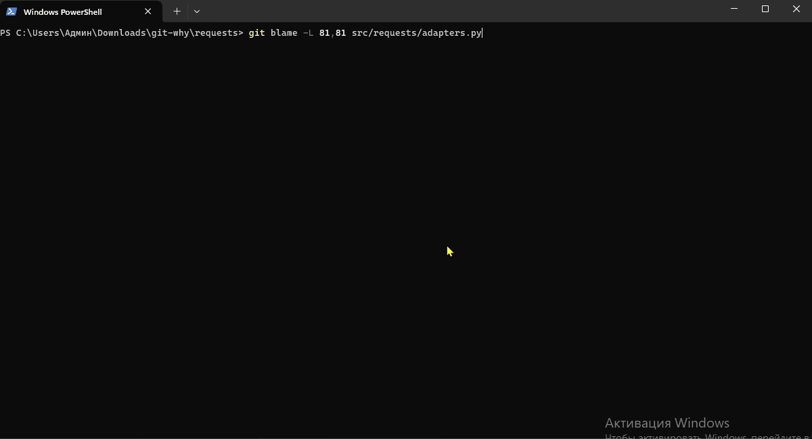

# git-why

> `git blame` tells you *who*. `git why` tells you *why*.

Point `git why` at a line and it reconstructs the line's **decision history**:
where it was born, which issue it fixed, every meaningful change since, who
reviewed it and what they said — following the line through renames, ignoring
formatter noise, and recovering history that `git blame` and `git log -L`
silently drop.



```
$ git why src/payments/retry.py:42
```

- **Deep git history** — line ranges, whole functions (`--function`), lines
  that no longer exist (`--text`), merge-commit edits (`--merges`).
- **Sees what `git blame` can't** — a recursive *pickaxe walk* finds
  side-branch changes lost to git's history simplification and tags them
  `⚡ invisible to git blame`.
- **Evidence, not guesses** — issue/PR references from commit messages and
  landing merges; with `--github`, the actual PR description and review
  comments. Facts are attributed to their source; the one-line summary is
  labelled *inferred*; every report carries a confidence level with reasons.
- **Works offline** — the GitHub integration is optional. No AI, no telemetry,
  no on-disk cache.
- **Scriptable** — `--format plain` for pipes, `--format json` for automation,
  documented exit codes.

## A real example

Line 81 of `src/requests/adapters.py` in [psf/requests](https://github.com/psf/requests)
is `DEFAULT_RETRIES = 0`. `git blame` says:

```
$ git blame -L 81,81 src/requests/adapters.py
2eb7e3c80 requests/adapters.py (Ian Cordasco 2014-10-24 22:23:15 -0500 81) DEFAULT_RETRIES = 0
```

`git why` (output captured verbatim, run without a token):

```
$ git why src/requests/adapters.py:81 --github

  src/requests/adapters.py:81
  │ DEFAULT_RETRIES = 0

  ● 2012-12-15  88d41430  "base adapter"  (Kenneth Reitz)
  │   line created here in requests/adapters.py
  │   + DEFAULT_RETRIES = 0
  evidence: weak  https://github.com/psf/requests/commit/88d41430186b98166e20f7b6d8f100c72fcd07b3
  ● 2014-09-10 (committed 2014-11-12)  2bc7762c  "Update how we handle retries to be consistent with documentation"  (Ian Cordasco)  ⚡ invisible to git blame
  │   - DEFAULT_RETRIES = 0
  │   + DEFAULT_RETRIES = object()
  │   landed via merge 90857b8b "Merge pull request #2216 from sigmavirus24/retries-take-2" on 2014-12-01
  ├─ landed via PR #2216
  │   PR #2216 Retries logic (merged, @sigmavirus24)
  │     https://github.com/psf/requests/pull/2216
  │     Currently our documentation tells user that by creating a custom `HTTPAdapter` they can pass `max_retries=n` and that will apply to connection and read retries. This is a lie at the moment (and has been probably since 2.4.0 was released with the new version of urllib3 that added the `Retry` class).
  │     In order to preserve backwards compatibility (and have passing tests) I remember upgrading the log…
  │     @kevinburke (comment): If you do `self.max_retries = Retry.from_int(max_retries)` doesn't this mean that you can only pass an integer number of retries?
  │     @sigmavirus24 (comment): I realize that using `0` will make it a magic number in this case. Perhaps on the sentinel object we set a `value`, e.g.,
  │     @sigmavirus24 (comment): > If you do self.max_retries = Retry.from_int(max_retries) doesn't this mean that you can only pass an integer number of retries?
  evidence: strong  https://github.com/psf/requests/commit/2bc7762cb6c91f49e5b116d3eb9f93af01e331f2
  ● 2014-10-24 (committed 2014-11-12)  2eb7e3c8  "Add last few changes and add a quick test"  (Ian Cordasco)  ⚡ invisible to git blame
  │   - DEFAULT_RETRIES = object()
  │   + DEFAULT_RETRIES = 0
  │   landed via merge 90857b8b "Merge pull request #2216 from sigmavirus24/retries-take-2" on 2014-12-01
  ├─ landed via PR #2216
  │   PR #2216 Retries logic (shown above)
  evidence: strong  https://github.com/psf/requests/commit/2eb7e3c80b345f6c6e13fadf6f1ba98efccdd2e2

  Summary (inferred): Introduced on 2012-12-15 by Kenneth Reitz ("base adapter"); changed meaningfully 2 times since, most recently on 2014-10-24 by Ian Cordasco; 2 commits recovered that git blame / git log -L cannot see.
  Confidence: high
    - edits made inside merge commits were not inspected (use --merges)
    - includes commits that git blame / git log -L cannot see (recovered via pickaxe)
```

The two middle commits are invisible to `git blame` *and* to `git log -L`:
they happened on a side branch whose final text matched mainline, so git's
history simplification skipped the whole branch. The PR discussion — "using
`0` will make it a magic number" — is the actual *why*.

Another one, same repository — a line that was created, deleted, and
re-created, each on a different branch, in one day:

```
$ git why src/requests/__version__.py:5

  src/requests/__version__.py:5
  │ __title__ = "requests"

  ● 2017-05-25  3e323567  "__version__.py"  (Kenneth Reitz)  ⚡ invisible to git blame
  │   line created here in requests/__version__.py
  │   + __title__ = 'requests'
  │   landed via merge 733ff4b8 "Merge branch 'master' of github.com:kennethreitz/requests" on 2017-05-25
  ✕ 2017-05-25  e038aad3  "Avoid breaking people using requests.__version__"  (Ian Cordasco)  ⚡ invisible to git blame
  │   line deleted here (it came back later)
  │   - __title__ = 'requests'
  │   Using __version__ as a module breaks users who expect
  │   requests.__version__ to be the version string.
  │   landed via merge 733ff4b8 "Merge branch 'master' of github.com:kennethreitz/requests" on 2017-05-25
  ● 2017-05-25  64efd9cf  "yay i knew i wasn't crazy"  (Kenneth Reitz)
  │   line re-created here in requests/__version__.py
  │   + __title__ = 'requests'
  ○ 2022-04-29  2a6f290b  Add automatic code formatting to Requests (#6095)   (looks like a style-only change, skipped)

  Summary (inferred): Introduced on 2017-05-25 by Kenneth Reitz ("__version__.py"); changed meaningfully 2 times since, most recently on 2017-05-25 by Kenneth Reitz; 1 formatting/move commit ignored; 2 commits recovered that git blame / git log -L cannot see.
  Confidence: high
    - edits made inside merge commits were not inspected (use --merges)
    - includes commits that git blame / git log -L cannot see (recovered via pickaxe)
```

## Installation

Requirements: **Python 3.10+** and **git 2.30+** on `PATH` (git 2.36+ enables
the `--remerge-diff`-based `--merges` mode; older versions fall back to a
first-parent diff). Tested in CI on Linux and macOS; Windows is expected to
work but is not part of CI yet.

```bash
pipx install git-why-trace        # or: pip install git-why-trace
# from source:
pip install .
```

Git automatically exposes any `git-<name>` executable as a subcommand, so both
`git-why …` and `git why …` work. (Note: `git why --help` is intercepted by git
itself, which looks for a man page; use `git why -h` or `git-why --help`.)

## Usage

```
git why FILE:LINE                    one line
git why FILE:START-END               a range (pickaxe cross-check for ranges ≤ 5 lines)
git why FILE -f/--function NAME      a whole function, tracked by git itself
git why FILE -t/--text 'exact line'  a line that no longer exists (file may be deleted too)

Options
  -g, --github            fetch linked issues / PRs / review comments
      --github-repo O/N   use this GitHub repository instead of the origin remote
  -m, --merges            inspect merge commits for edits made during conflict resolution
  -F, --format FORMAT     auto (default) | rich | plain | json
      --json              shortcut for --format json
  -a, --all               do not dim formatting / move commits
      --no-pickaxe        git log -L only (faster; may miss side-branch changes)
      --no-color          no colours in rich output
      --max-body N        commit-message lines shown per commit (default 6)
      --debug             search statistics on stderr (never prints secrets)
  -V, --version
  -h, --help
```

`--format auto` picks `rich` on a terminal and `plain` when piped. `git why -h`
prints the same options with examples.

### Exit codes

| Code | Meaning |
|---|---|
| 0 | a report was produced (GitHub problems only produce warnings) |
| 1 | usage / input error: bad target syntax, missing file, line out of range, ambiguous function name |
| 2 | git error: not a repository, no commits, file not tracked at HEAD, binary file |
| 3 | the target is valid but no commit touches it |

### JSON output

`--json` emits a stable document (`schema_version: 1`), oldest commit first:

```json
{
  "schema_version": 1,
  "generator": {"name": "git-why", "version": "0.1.1"},
  "target": {"file": "src/requests/adapters.py", "start": 81, "end": 81, "function": null, "text": null, "lines": ["DEFAULT_RETRIES = 0"]},
  "repo": {"root": "...", "head": "...", "shallow": false, "web_url": "https://github.com/psf/requests"},
  "strategies": {"range_tracking": true, "pickaxe": true, "lineage_complete": true, "merge_scan": false, "github": false},
  "confidence": {"level": "high", "reasons": ["..."]},
  "summary": {"text": "...", "source": "inferred from the evidence below"},
  "steps": [
    {
      "sha": "2bc7762cb6c91f49e5b116d3eb9f93af01e331f2", "short_sha": "2bc7762c",
      "url": "https://github.com/psf/requests/commit/2bc7762cb6c91f49e5b116d3eb9f93af01e331f2",
      "date": "2014-09-10T11:57:20-05:00", "committed": "2014-11-12T13:56:28-06:00", "author": "Ian Cordasco", "author_email": "...",
      "subject": "Update how we handle retries to be consistent with documentation", "body": "",
      "kind": "change", "found_by": "pickaxe", "is_merge": false, "noise_reason": null, "shallow_boundary": false,
      "file_before": "requests/adapters.py", "file_after": "requests/adapters.py",
      "removed": ["DEFAULT_RETRIES = 0"], "added": ["DEFAULT_RETRIES = object()"],
      "references": [{"kind": "pr", "id": "2216", "how": "landed via", "repo": null}],
      "landed_via": {"sha": "90857b8b…", "short_sha": "90857b8b", "subject": "Merge pull request #2216 from sigmavirus24/retries-take-2", "date": "2014-12-01T14:45:27-05:00", "url": "..."},
      "evidence_strength": "medium",
      "github_threads": []
    }
  ],
  "github": {"enabled": false, "repo": null, "authenticated": false, "requests_made": 0, "rate_limited": false, "offline": false, "warnings": []},
  "warnings": []
}
```

`kind` is one of `origin`, `change`, `deletion`, `noise`; `found_by` is
`range` (git log -L), `pickaxe` or `merge`; `evidence_strength` is
`weak` (subject only), `medium` (commit body *or* a reference) or `strong`
(body *and* reference, or a fetched discussion).

### GitHub integration

```bash
export GITHUB_TOKEN=...        # optional; or GH_TOKEN
git why src/app.py:42 --github
```

- The repository is taken from the `origin` remote (HTTPS or SSH URL);
  override with `--github-repo OWNER/NAME`. GitHub Enterprise: set
  `GITHUB_API_URL=https://ghe.example.com/api/v3`.
- Without a token the public API allows 60 requests/hour; with one, 5 000. A
  run makes at most 40 requests and fetches at most 12 threads.
- Fetched per thread: title, state (open/closed/merged), author, labels, a
  400-character excerpt of the description, issues it closes, up to five
  human (non-bot) review comments / review summaries / issue comments, and
  the PR a commit belongs to according to GitHub.
- Rate limits, 401/403/404, server errors, malformed responses and network
  failures degrade to a warning; the local report is always produced and the
  exit code is unaffected.

## How it works

```
resolve target ─► git log -L ─► pickaxe walk ─► merges ─► noise ─► GitHub ─► report
```

1. **Range tracking.** `git log -L <lines>:<file>` (or `-L :<regex>:<file>`
   for `--function`) follows the lines back through history, across renames.
   For `--function`, git's *built-in* language diff driver is enabled through
   a temporary attributes file so that indented methods count as function
   headers; the function name is checked for ambiguity first because git would
   silently take the first match.
2. **The pickaxe walk.** `git log -L` and `git blame` apply *history
   simplification*: at a merge, if one parent already has the exact same text,
   the other side is ignored — so a change made and reverted on a branch, or a
   line dropped and re-added, disappears. `git log -G"<exact line>"` has no
   such blind spot but knows only one text. So we walk: find the commit that
   *added* the current text, take the most similar *removed* line in the same
   hunk as its previous version, recurse. Each search runs `--follow` (to
   discover old paths) plus `--full-history` over every known path, because
   `--follow` alone drops commits too. The walk stops at lines too generic to
   search (`}`, `pass`) and at points where the same text occurs twice in the
   file (ambiguous).
3. **Merging strategies.** Both timelines are united by commit and ordered by
   *commit* time (ties broken topologically), which is the order the diffs
   apply in. The date shown is the author date, as in `git log`; when a commit
   was rebased or cherry-picked later, the header also shows
   `(committed YYYY-MM-DD)` so the order never looks wrong. The set of texts
   learned by the walk — the *lineage* — trims `git log -L`'s *range drift*:
   after a commit replaces N lines with M, `-L` widens the tracked range and
   reports changes to neighbouring lines.
4. **Merges.** Every side-branch commit is annotated with the merge that landed
   it on the mainline (which is where `Merge pull request #N` lives). Merge
   commits that `-L` lists get their real edits via `git --remerge-diff`; a
   merge that only combined both sides' changes is dimmed as a *pass-through
   merge*, never shown as an edit. With
   `--merges`, every merge the file was part of is diffed the same way and
   edits to our line that no ordinary commit explains are reported as
   `changed by the merge itself`.
5. **Noise.** Hunks compared with whitespace removed: identical → formatter
   run or move; blank-lines-only; style-labelled commits with near-identical
   text. Noise is dimmed, never deleted.
6. **References & evidence.** `Fixes #412`, `(#1180)`, `PR #7`, `GH-9`,
   `PAY-77`, `owner/repo#12`, GitHub URLs. With `--github` the threads behind
   them are fetched. Per commit, *evidence strength* says how much explanation
   exists; per report, *confidence* says how complete the history is likely to
   be and why (shallow clone, incomplete walk, large range, merges not
   scanned).

Everything in the timeline is quoted from git or GitHub. The only text the
tool composes itself is the one-line summary, and it is labelled *inferred*
and built solely from counts and dates in the report. When evidence is
missing, the report says so (`evidence: weak`) instead of guessing.

## Limitations

- **`--merges` semantics depend on git.** With git ≥ 2.36 it uses
  `--remerge-diff`, which shows only what a merge changed beyond the automatic
  merge result. A merge that cleanly applied a deletion from one side is *not*
  an edit by the merge — the deleting commit itself is reported instead (the
  pickaxe finds it). On older git the fallback is a first-parent diff,
  de-duplicated against the side branch's own commits; it can miss edits whose
  result happens to equal a parent.
- **Heuristics are heuristics.** Choosing the "previous version" of a line by
  text similarity (threshold 0.45) can pick the wrong line in a large rewrite
  hunk; the walk then stops early and confidence is downgraded with a reason.
- **Duplicated lines.** If the identical text appears several times in a file,
  the pickaxe cannot tell them apart and stops; `git log -L` carries the rest.
- **Generic lines** (`}`, `return`, `pass`) are only tracked with `-L`.
- **Ranges over 5 lines** are not cross-checked with the pickaxe (too slow);
  the confidence reasons say so.
- **`--function`** locates the header with a language-agnostic regex and
  estimates the extent for display; history itself comes from git. Languages
  without a built-in git diff driver fall back to the estimated line range,
  with a warning.
- **Line numbers refer to HEAD.** Uncommitted edits produce a warning.
- **Shallow clones** are detected; commits at the clone boundary are flagged
  and confidence is `low`.
- **Cross-repository references** (`other/repo#12`) are shown but not fetched.

## Security

See [SECURITY.md](SECURITY.md). In short: read-only git commands, HTTPS GET
requests only, token from the environment and never printed, logged, stored or
serialised; no on-disk cache; rich markup from commit messages is escaped.

## Development

```bash
pip install -e ".[dev]"
ruff check git_why tests && ruff format --check git_why tests
mypy && mypy tests
python -m pytest --cov
python -m build && twine check --strict dist/*
```

The test suite builds throwaway git repositories (including one that
reproduces git's merge blind spot and asserts that `git log -L` alone misses
it) and mocks the GitHub API; it needs no network and no credentials. See
[CONTRIBUTING.md](CONTRIBUTING.md) for the project layout and release process,
and [CHANGELOG.md](CHANGELOG.md) for history.

## License

[MIT](LICENSE).
